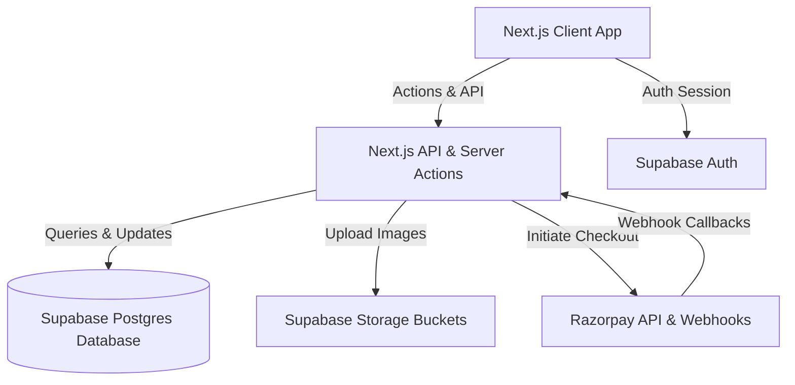

# PRD — BLUMI

## 1. Overview

### Product Summary
BLUMI is an interactive clothes-swapping platform styled as an editorial fashion magazine. It helps young fashion lovers list their wardrobe, browse items in a Tinder-style swiping interface, select which of their own clothes they wish to offer, and instantly swap clothes when there is a mutual match. If preferred, users can also buy liked items directly using a checkout cart flow.

### Objective
This PRD outlines the technical specifications for the BLUMI MVP. The core objectives are:
* Provide a single-click secure Google authentication mechanism.
* Enable users to easily manage their closet (adding items with title, brand, size, description, category, and minimum 4 images).
* Implement the interactive Tinder-like swiping deck where users offer an item from their closet to trade for recommended items.
* Detect mutual right-swipes and trigger the match overlay celebration.
* Provide a direct checkout cart and Razorpay payment gateway to buy liked items directly.
* List active, pending, and completed matches in a dashboard.

### Market Differentiation
Traditional resale platforms like Depop and Vinted require significant listing management, messaging negotiations, lowball offers, and seller fees. BLUMI differentiates by using a **mutual swiping swap engine**. By removing the cash valuation from the initial transaction and replacing it with direct trades, BLUMI creates a frictionless, low-pressure circular wardrobe experience.

### Magic Moment
The magic moment occurs when a user swipes right on an item they want, and is immediately greeted by the "It's a Match!" celebration screen showing their own item side-by-side with the matched item, complete with custom editorial styling, washi-tape decorations, and confetti. The technical system must evaluate matches instantly on swipe submissions to trigger this.

### Success Criteria
* Swap matching logic completes in <200ms.
* Image upload handles 4 slots concurrently with automatic background optimization.
* Razorpay payment status syncs within 2 seconds of webhook receipt.
* Fully responsive web interface with a consistent editorial scrapbook aesthetic across desktop and mobile screen widths.

---

## 2. Technical Architecture

### Architecture Overview


### Chosen Stack
| Layer | Choice | Rationale |
| --- | --- | --- |
| **Frontend** | Next.js (React / TS) | SEO-ready page rendering, rapid development with file system routing and Server Actions. |
| **Backend** | Next.js Server Actions / API Routes | Streamlined TypeScript types shared between client and server, minimal boilerplate. |
| **Database** | Supabase Postgres | Native relational schema supporting foreign key matching, instant real-time triggers. |
| **Auth** | Supabase Auth | Pre-built secure social login (Google) and token session persistence. |
| **Payments** | Razorpay | Standard developer-friendly checkout integration and webhook notifications for Indian markets. |
| **Storage** | Supabase Storage | Built-in media bucket support for listing images. |
| **Analytics** | None | Skipped for early development. |
| **Email** | None | Skipped for early development. |
| **Error tracking** | None | Skipped for early development. |

### Stack Integration Guide
1. **Supabase Client Init:** Configure `@supabase/supabase-js` inside `src/lib/supabase.ts` using environmental service role and public anon keys.
2. **Supabase Auth Hook:** Setup authentication middleware in `src/middleware.ts` to block unauthorized access to `/swipe`, `/closet`, and `/matches`.
3. **Database Client Pool:** Use direct SQL queries or Prisma-like interface to access Supabase PostgreSQL.
4. **Razorpay SDK:** Integrate the client-side Razorpay checkout script on checkout pages, matching with backend invoice creation endpoint.
5. **Required Environment Variables:**
   * `NEXT_PUBLIC_SUPABASE_URL`
   * `NEXT_PUBLIC_SUPABASE_ANON_KEY`
   * `SUPABASE_SERVICE_ROLE_KEY`
   * `RAZORPAY_KEY_ID`
   * `RAZORPAY_KEY_SECRET`
   * `RAZORPAY_WEBHOOK_SECRET`

### Repository Structure
```
project-root/
├── public/                   # Static mock assets & collage imagery
├── src/
│   ├── actions/              # Next.js Server Actions (products, likes, swipes, matches)
│   ├── app/                  # Next.js Page Router
│   │   ├── api/              # API endpoints (razorpay webhook, valuation)
│   │   ├── closet/           # Closet manager pages
│   │   ├── liked/            # Liked items list
│   │   ├── matches/          # Swapped matches dashboard
│   │   ├── swipe/            # Tinder-like swiping deck
│   │   ├── layout.tsx        # Global scrapbook fonts & styling
│   │   └── page.tsx          # Editorial landing page
│   ├── components/           # Reusable UI components
│   │   ├── Header.tsx        # Frosted glass scrapbook navigation
│   │   ├── SwipeCard.tsx     # Polaroid item card
│   │   ├── SwipeDeck.tsx     # Interactive drag deck
│   │   └── MatchPopup.tsx    # Confetti celebration overlay
│   ├── db/                   # Database schemas and connections
│   ├── styles/               # Global CSS files (scrapbook styling tokens)
│   └── types/                # TypeScript interface definitions
```

### Infrastructure & Deployment
* **Hosting:** Vercel for the Next.js serverless application.
* **Database & Storage:** Supabase Cloud console.
* **CD/CD:** Automatic branch builds on GitHub commits.

### Security Considerations
* **Server-side validation:** File size limits (<5MB) and mime-type checks for clothing images.
* **Row-Level Security (RLS):** Supabase database tables must restrict read/write access to matching owner IDs.
* **Razorpay signature validation:** Backend `/api/checkout/webhook` must verify signature hashes before updating order status.

### Cost Estimate
* **Vercel Hobby:** $0/mo (first 1000 users).
* **Supabase Free Tier:** $0/mo (500MB DB space, 1GB Storage space).
* **Razorpay:** Commission per successful buyout checkout transaction (~2%).
* **Total launch cost:** $0/month.

---

## 3. Data Model

### Entity Definitions
```sql
-- Profiles Table
CREATE TABLE profiles (
    id UUID PRIMARY KEY REFERENCES auth.users(id) ON DELETE CASCADE,
    name TEXT NOT NULL,
    avatar_url TEXT,
    created_at TIMESTAMPTZ DEFAULT NOW(),
    updated_at TIMESTAMPTZ DEFAULT NOW()
);

-- Products Table
CREATE TABLE products (
    id UUID PRIMARY KEY DEFAULT gen_random_uuid(),
    owner_id UUID NOT NULL REFERENCES profiles(id) ON DELETE CASCADE,
    title TEXT NOT NULL,
    description TEXT,
    brand TEXT,
    size TEXT NOT NULL,
    category TEXT NOT NULL,
    condition TEXT NOT NULL,
    price NUMERIC(10, 2) NOT NULL DEFAULT 0.00,
    images TEXT[] NOT NULL DEFAULT '{}', -- Requires minimum 4 elements
    status TEXT NOT NULL DEFAULT 'AVAILABLE', -- AVAILABLE, EXCHANGED, SOLD
    created_at TIMESTAMPTZ DEFAULT NOW(),
    updated_at TIMESTAMPTZ DEFAULT NOW()
);

-- Swipes Table
CREATE TABLE swipes (
    id UUID PRIMARY KEY DEFAULT gen_random_uuid(),
    swiper_id UUID NOT NULL REFERENCES profiles(id) ON DELETE CASCADE,
    product_id UUID NOT NULL REFERENCES products(id) ON DELETE CASCADE,
    offered_product_id UUID NOT NULL REFERENCES products(id) ON DELETE CASCADE,
    direction TEXT NOT NULL, -- LIKE, PASS
    created_at TIMESTAMPTZ DEFAULT NOW(),
    UNIQUE(swiper_id, product_id, offered_product_id)
);

-- Matches Table
CREATE TABLE matches (
    id UUID PRIMARY KEY DEFAULT gen_random_uuid(),
    swiper_a_id UUID NOT NULL REFERENCES profiles(id) ON DELETE CASCADE,
    swiper_b_id UUID NOT NULL REFERENCES profiles(id) ON DELETE CASCADE,
    product_a_id UUID NOT NULL REFERENCES products(id) ON DELETE CASCADE,
    product_b_id UUID NOT NULL REFERENCES products(id) ON DELETE CASCADE,
    status TEXT NOT NULL DEFAULT 'PENDING', -- PENDING, COMPLETED, DECLINED
    created_at TIMESTAMPTZ DEFAULT NOW(),
    updated_at TIMESTAMPTZ DEFAULT NOW()
);
```

### Relationships
* **products.owner_id:** Many-to-one with `profiles.id`.
* **swipes.swiper_id:** Many-to-one with `profiles.id`.
* **swipes.product_id / swipes.offered_product_id:** Many-to-one with `products.id`.
* **matches.product_a_id / matches.product_b_id:** Many-to-one with `products.id`.

### Indexes
* `swipes_swiper_id_idx` on `swipes(swiper_id)` for quick check of swiped items.
* `products_owner_id_idx` on `products(owner_id)` for listing user's closet.
* `matches_swiper_a_id_idx`, `matches_swiper_b_id_idx` on `matches(swiper_a_id, swiper_b_id)` for rendering matches dashboard.

---

## 4. API Specification

### API Design Philosophy
BLUMI utilizes **Next.js Server Actions** for core transactional database operations (liking, listing, matching) to share TypeScript schemas directly. Public integrations (Razorpay Webhooks and AI Valuations) use standard HTTP endpoints.

### Endpoints

#### 1. Razorpay Gateway Webhook
* **POST** `/api/checkout/webhook`
* **Auth:** None (Signature validation header check)
* **Request Body:** Standard Razorpay event JSON payload.
* **Response 200:** `{ "status": "ok" }`

#### 2. Server Action: Swipe Action
* `swipeProduct(productId: string, offeredProductId: string, direction: 'LIKE' | 'PASS')`
* **Response:** `{ success: boolean, match?: Match }`

#### 3. Server Action: List Closet Item
* `createProduct(formData: FormData)`
* **Response:** `{ success: boolean, product?: Product, error?: string }`

---

## 5. User Stories
* **US-01:** As a swapper, I want to upload at least 4 photos of my shirt so that potential swappers can check its condition.
* **US-02:** As a swapper, I want to choose which of my active items to offer before swiping so that I trade the correct clothes.
* **US-03:** As a swapper, I want to see the match celebration pop-up immediately when a mutual right-swipe occurs so that I feel the excitement.
* **US-04:** As a swapper, I want to check my active matches and find the owner's details so that we can organize shipping or meetup.
* **US-05:** As a user, I want to purchase an item directly from my liked page so that I don't miss out on items I love.

---

## 6. Functional Requirements
* **FR-001 (P0):** Closet item upload must validate that at least 4 image slots are filled.
* **FR-002 (P0):** The swiping deck must filter out the swiper's own items and items they have already swiped on.
* **FR-003 (P0):** Match engine must check if the owner of target item has previously right-swiped on the offered item, writing a record to the matches table on mutual like.
* **FR-004 (P1):** Integrated shopping cart must support adding liked items and proceeding to Razorpay checkout.
* **FR-005 (P1):** Successful checkout transactions must update the product status to `SOLD` and match status to `COMPLETED`.

---

## 7. Non-Functional Requirements
* **NFR-001:** Fully responsive interface matching the editorial design system across desktop and mobile screens.
* **NFR-002:** Client page weight must remain lightweight (<150KB CSS bundle).
* **NFR-003:** Secure image storage using signed URLs or public cache controls.

---

## 8. UI/UX Requirements
* **Theme:** Scrapbook thrift style. Background color must use Cream (`#FAF7F2`), primary text Espresso (`#2C1810`).
* **Polaroids:** Items must render on white boards with a handwritten annotation using the `Caveat` font.
* **Match celebration:** Modal dimming backdrop with floating confetti particles and matching Polaroid comparisons.

---

## 9. Auth Implementation
* Powered by **Supabase Auth**. Users sign in via Google OAuth. Session tokens are verified on server calls.

---

## 10. Payment Integration
* Powered by **Razorpay Standard Integration**. Invoices are initiated on `/checkout` and completed payments trigger verified webhooks.

---

## 11. Edge Cases & Error Handling
* **Self Swiping:** UI must prevent a user from swiping on their own items.
* **Double Swipes:** Database locks prevent multiple swipe records for the same product-offering combination.
* **Refunded Checkout:** If order is cancelled or unpaid, item status reverts to `AVAILABLE`.

---

## 12. Dependencies & Integrations
* `@supabase/supabase-js`
* `razorpay`
* `lucide-react`
* `canvas-confetti`

---

## 13. Out of Scope
* In-app instant messaging.
* Auto-generated courier shipping labels.

---

## 14. Open Questions
* *None for MVP.*
